# Kibo-RPC 7th Programming Manual

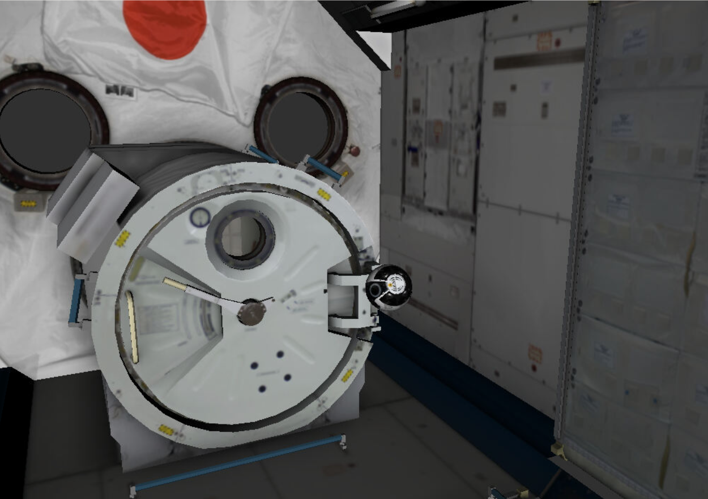

| Item | Content |
|---|---|
| Audience | Kibo-RPC 7th participants |
| Version | 1.0 |
| Last Updated | 2026-10-05 |
| Publisher | Japan Aerospace Exploration Agency (JAXA) |
| Contact | z-krpc7@ml.jaxa.jp |

## Revision History

| Revision Date | Version | Paragraph | Revision Location |
|---|---|---|---|
| 2026-10-05 | 1.0 | - | - |

# About This Document

This manual explains how to develop, build, simulate, and run applications for Int-Ball2 using the Web and local simulators.

This document is structured so that readers who are participating in Kibo-RPC for the first time can proceed step by step, from preparing the development environment to running the program and checking the results.

## Target Readers

- People developing an application for Int-Ball2 for the first time
- People who want to verify their program using the simulator
- People who want to check the development environment or the API specification

## What You Will Be Able to Do After Reading This Document

After reading this document, you will be able to:

- Prepare the environment required for development
- Create an application from the provided sample code
- Run your program on the Web simulator and the local simulator
- Check the execution status, logs, and simulation results
- Check the role and usage of the Kibo-RPC API

# Notation Conventions

| Notation | Meaning |
|---|---|
| `command` | A value you enter or reference in code or a terminal, such as a command, API name, message type, file name, directory name, or configuration value |
| `[Screen Item]` | A screen element such as a button, menu, or tab |
| `<PLACEHOLDER>` | A value to be replaced depending on the user or environment. This excludes syntax elements in code blocks |

> [!NOTE]
> Indicates supplementary information about a procedure or specification.

> [!CHECK]
> Indicates items to confirm related to mandatory conditions, prior checks, safety, operation on actual hardware, and submissions.

> [!WARNING]
> Indicates items where a mistaken operation or misconfiguration could stop the program, cause data loss, or affect the equipment.

> [!TIP]
> Indicates supplementary information or recommendations to help you proceed with your work.

# Table of Contents

1. [Introduction](#1-introduction)
2. [Setup](#2-setup)
3. [Creating Your Application](#3-creating-your-application)
4. [Running Your Program in the Simulator](#4-running-your-program-in-the-simulator)
5. [Tips for Programming](#5-tips-for-programming)
6. [Game API Details](#6-game-api-details)

## Structure of This Document

| Chapter | Content |
|---|---|
| Chapter 1 | Purpose of this document, target audience, and overview of development |
| Chapter 2 | Operating environment and setup of development tools |
| Chapter 3 | Creating a project, implementation, configuration, and building |
| Chapter 4 | Running your program on the Web simulator and the local simulator |
| Chapter 5 | Design tips for building a stable program |
| Chapter 6 | List and details of the Game API |

# 1. Introduction

## 1.1 About Int-Ball2

> _Int-Ball2 is an intra-vehicular drone designed to support astronauts aboard the International Space Station (ISS)._
>
> _Astronauts work together with ground controllers to carry out various experiments and maintenance activities on the ISS. Int-Ball2 can be remotely operated from the ground to fly inside the ISS and capture photos and videos on behalf of astronauts._
> _Currently, astronauts are responsible for preparing cameras and capturing photos and videos inside the Japanese Experiment Module “Kibo”. By enabling Int-Ball2 to perform these tasks through remote operation from the ground, the time astronauts spend on camera preparation and filming can be reduced._

Source: [JAXA Human Spaceflight Technology Directorate website](https://humans-in-space.jaxa.jp/news/detail/003155.html)

## 1.2 Overview of Programming

Developing an application for Int-Ball2 generally follows the workflow below.

1. Prepare the development environment
2. Obtain the working directory provided by Kibo-RPC
3. Create an application
4. Verify its behavior in the simulator
5. Check the logs and execution results
6. Modify the program as needed

## 1.3 Precautions Before Starting Development

- In addition to this document, check the latest rule book and guidebook, simulator operating procedures, simulator version information, and constraints related to creating and submitting programs.
- The simulator and the actual Int-Ball2 hardware may differ in the available functions and behavioral characteristics.
- Design your program to prioritize safety and stability, not only for programs used on the actual hardware but also for programs used in the simulator.
- Do not update tools or libraries for which a version is specified at your own discretion.
- Back up your work and perform prior checks before making important configuration changes or operating the actual hardware.

# 2. Setup

## 2.1 Setup Flow

> [!NOTE]
> **About the difference between "Linux" and "Ubuntu"**
> This document frequently uses the term "Linux environment," which refers to an environment where "Ubuntu," a specific Linux distribution (one type of Linux), has been installed. Many other Linux distributions exist, but this document explains the procedures assuming Ubuntu.
>
> - **Linux**: A general term referring to a type of OS. There are many kinds (distributions) besides Ubuntu.
> - **Ubuntu**: One Linux distribution, and the environment this document targets.
> - **WSL2**: A mechanism (Windows Subsystem for Linux 2) for running a Linux (Ubuntu) environment on Windows. If you are using Windows, use WSL2 to prepare an Ubuntu environment on Windows. See [2.4.1 Installing WSL2 and Ubuntu on Windows 11](#241-installing-wsl2-and-ubuntu-on-windows-11) for the procedure.
>
> From this point on, whenever this document simply says "Linux environment," it means "an Ubuntu environment (Ubuntu on WSL2 if you are using Windows)."

The setup required differs depending on which simulator you use.

- **If you only use the Web simulator**: Prepare a Linux environment (Ubuntu), perform [2.5 Obtaining Development Resources](#25-obtaining-development-resources), and then proceed to the procedures in [3. Creating Your Application](#3-creating-your-application). Installing Docker is not required.
- **If you also use the local simulator**: Check the operating environment, install Docker in [2.4 Installing Basic Tools](#24-installing-basic-tools), obtain the development resources, and then proceed to the procedures in [3. Creating Your Application](#3-creating-your-application) and [4.4 Local Simulator](#44-local-simulator).

> [!NOTE]
> In either case, a Linux environment (Ubuntu) is required to extract the development resources and to create the submission package. If you are using Windows, use Ubuntu on WSL2.

## 2.2 Operating Environment

> [!NOTE]
> The required conditions differ depending on whether you run the local simulator.
>
> - **If you only use the Web simulator**: Checking the hardware requirements in [2.2.1 Operating Environment for Running the Local Simulator](#221-operating-environment-for-running-the-local-simulator) and installing Docker ([2.4.2](#242-installing-docker)) are not required. However, if you use Windows, installing WSL2 and Ubuntu ([2.4.1](#241-installing-wsl2-and-ubuntu-on-windows-11)) is required, because a Linux environment (Ubuntu) is needed to extract the development resources and create the submission package.
> - **If you also use the local simulator**: You must meet the hardware requirements in [2.2.1 Operating Environment for Running the Local Simulator](#221-operating-environment-for-running-the-local-simulator) and install Docker ([2.4.2](#242-installing-docker)). If you use Windows, you also need to install WSL2 and Ubuntu ([2.4.1](#241-installing-wsl2-and-ubuntu-on-windows-11)).

### 2.2.1 Operating Environment for Running the Local Simulator

| Item | Minimum | Recommended | Notes |
|---|---|---|---|
| OS | Ubuntu 20.04 or later | Ubuntu 24.04 | If using Windows 11, use Ubuntu on WSL2 |
| CPU | 4 cores or more | 6 cores or more | Affects running multiple processes concurrently |
| Memory | 8 GB or more | 16 GB or more | Be careful of memory shortages when using WSL2 |
| Storage | 20 GB or more of free space | 40 GB or more recommended | SSD recommended |

### 2.2.2 About the Usage Environment

- If memory is insufficient in the local environment, check the WSL2 memory settings and stop unnecessary applications or processes running in Windows and WSL2.
- If the simulator does not run properly, close unnecessary applications and background processes to free up memory and CPU resources, and then run it again.
- If you are unable to set up a local environment, use the Web simulator instead.  
  See [4.2 Web Simulator](#42-web-simulator) for how to use it.

> [!CHECK]
> To use the local simulator on Windows 11, install WSL2, create an Ubuntu environment, and then run it.
> Running it on Windows 11 alone (without WSL2) is not supported.

### 2.2.3 Notes on Using WSL2

> [!WARNING]
> Running the simulator on WSL2 is possible, but insufficient memory may cause unstable behavior.
> Close unnecessary background applications and ensure sufficient memory is available before running it.
> For details on setting up Docker and WSL2, refer to [the official WSL documentation](https://learn.microsoft.com/windows/wsl/install) and the setup guide for each environment.

## 2.3 Required Software

| Software | Purpose | Required / Recommended |
|---|---|---|
| VSCode | Editing source code | Recommended |
| Git | Managing source code | Recommended |
| Docker | Running the local simulator | Required |

The simulator environment is based on the following software versions.

| Item | Version |
|---|---|
| GCC | 7.5.0 |
| C++ | C++14 |
| Python | 3.6.9 |
| ROS | ROS 1 Melodic |

## 2.4 Installing Basic Tools

> [!NOTE]
> This section explains how to install WSL2, Ubuntu, and Docker to run the local simulator.
> If you already use Ubuntu, or if you have already installed WSL2 and Ubuntu, proceed from [2.4.2 Installing Docker](#242-installing-docker).

### 2.4.1 Installing WSL2 and Ubuntu on Windows 11

If you use Windows 11, prepare an Ubuntu environment on WSL2 to extract the development resources and create the submission package. The local simulator also runs in this environment.  
Launch Command Prompt or PowerShell on Windows as an administrator and run the following.

```powershell
wsl --install -d Ubuntu-24.04
```

After installation, when Ubuntu starts, follow the on-screen instructions to set your username and password.

> [!NOTE]
> If Windows asks you to restart, run the following command to restart Windows. After restarting, launch Ubuntu and set your username and password.

```powershell
shutdown /r /t 0
```

Once the setup is complete, run the following in Windows PowerShell to confirm that WSL2 is being used.

```powershell
wsl --list --verbose
```

Confirm that the VERSION for Ubuntu is `2`. If VERSION is `1`, run the following in PowerShell with administrator privileges to switch it to WSL2. For `<DISTRO_NAME>`, specify the distribution name exactly as shown in the NAME column of `wsl --list --verbose` (for example, `Ubuntu-24.04`).

```powershell
wsl --set-version <DISTRO_NAME> 2
```

> [!CHECK]
> Using WSL2 and Ubuntu is mandatory to run the local simulator on Windows 11. Rather than running the simulator directly from Windows Command Prompt or PowerShell, run the following procedures in an Ubuntu terminal.

### 2.4.2 Installing Docker

In the Ubuntu terminal, run the following to register Docker's official repository and install Docker Engine.

```bash
sudo apt-get update
sudo apt-get install -y ca-certificates curl gnupg
sudo install -m 0755 -d /etc/apt/keyrings
curl -fsSL https://download.docker.com/linux/ubuntu/gpg | sudo gpg --dearmor -o /etc/apt/keyrings/docker.gpg
sudo chmod a+r /etc/apt/keyrings/docker.gpg

echo \
  "deb [arch=$(dpkg --print-architecture) signed-by=/etc/apt/keyrings/docker.gpg] https://download.docker.com/linux/ubuntu \
  $(. /etc/os-release && echo \"$VERSION_CODENAME\") stable" | \
  sudo tee /etc/apt/sources.list.d/docker.list > /dev/null

sudo apt-get update
sudo apt-get install -y docker-ce docker-ce-cli containerd.io docker-buildx-plugin docker-compose-plugin
```

Configure Docker so it can be run by a regular user, and restart Ubuntu to apply the settings.

```bash
sudo usermod -aG docker $USER
```

After closing and restarting your Ubuntu terminal on WSL, confirm that Docker is available by running the following.

```bash
docker run hello-world
```

### 2.4.3 Installing Recommended Tools (Git and VSCode)

Git and an editor are used to obtain and edit the program. Neither is mandatory, but this document recommends Git and VSCode (Visual Studio Code), which are free to use and easy to operate.

#### Installing Git

Because Git is used within Ubuntu on WSL2, install it in your Ubuntu environment.

```bash
sudo apt-get update
sudo apt-get install -y git
git --version
```

Run `git --version` and confirm that the Git version is displayed.

#### Installing VSCode

You may use any editor you like. This document recommends Visual Studio Code (VSCode), which is free to use, has a rich set of extensions, and integrates easily with WSL2. Download and install the Windows installer from the official site below.

- [Visual Studio Code](https://code.visualstudio.com/Download)

> [!CHECK]
> If you use VSCode on Windows 11, connect from the VSCode installed on the Windows side to the Ubuntu environment on WSL2.
> Rather than editing files on the Windows side directly, open and edit the workspace inside the Ubuntu environment.

From the VSCode Extensions view, install the following extension.

- [WSL Extension](https://marketplace.visualstudio.com/items?itemName=ms-vscode-remote.remote-wsl)

Once the extension is installed, you will be able to connect from VSCode to the Ubuntu environment on WSL2.
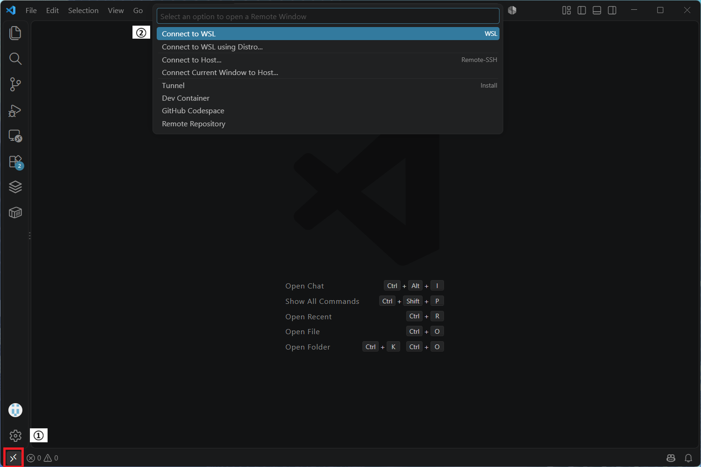

1. Click the "><" icon in the bottom-left corner.
2. Select [Connect to WSL].

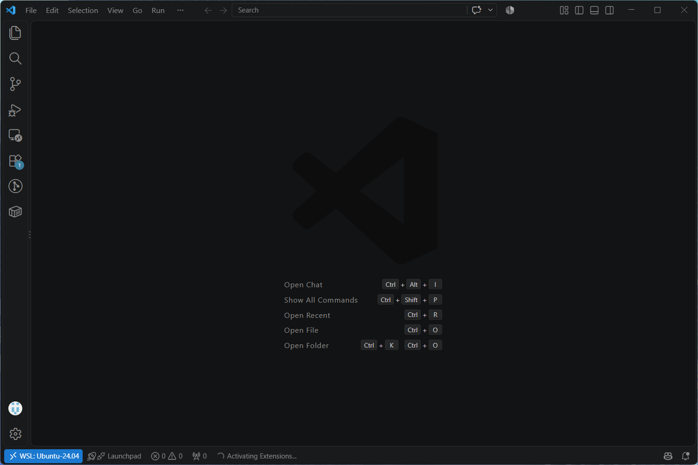

- If "WSL: Ubuntu" is displayed in the bottom-left corner, you are connected to the Ubuntu environment on WSL2.

## 2.5 Obtaining Development Resources

The resources required for development are provided as a GZIP-format archive file.
Obtain the target archive file from the download page below.

- [Download | Kibo Robot Programming Challenge](https://jaxa.krpc.jp/download)

> [!NOTE]
> The distribution format and location may change in the future.

### 2.5.1 Obtaining the Development Resources

1. Access [Download | Kibo Robot Programming Challenge](https://jaxa.krpc.jp/download).
2. Download the tar file containing the development resources (KRPC7 Simulator Resources).
3. Confirm that the downloaded file is not corrupted.

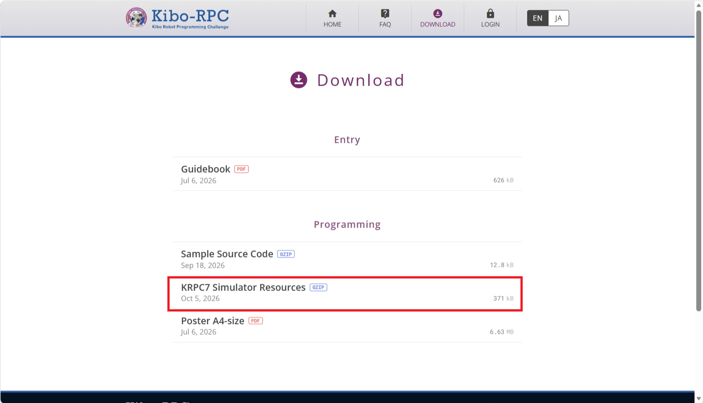

### 2.5.2 Extracting the Development Resources

In an Ubuntu terminal (or Ubuntu on WSL2), extract the downloaded tar file to any working directory.

```bash
mkdir -p ~/krpc
tar -xvf krpc7th-simulator.tar.gz -C ~/krpc
```

Extracting the tar file produces the directory structure below.
From this point on, this document assumes the `krpc7th-simulator/` directory extracted in section 2.5.2.

```text
krpc7th-simulator/
├── build.sh                       # Script that builds the simulator
├── simulation.sh                  # Script that launches and runs the simulator once
├── replay.sh                      # Script that replays the execution results (rosbag)
├── docker-compose.yaml            # Definition of the simulator body and the user program container
├── docker-compose.replay.yaml     # Definition of the replay container
├── README.md
├── docs/                          # Manuals and screen captures
│   ├── ProgrammingManual.md       # English manual
│   ├── ProgrammingManual_ja.md    # Japanese manual
│   └── images/                    # Images used in the manuals
├── docker/                        # Build definitions for the simulator image (do not edit)
│   ├── Dockerfile.krpc-base       # Build definition for the simulator body (ROS/Gazebo, etc.)
│   ├── Dockerfile.krpc-replay     # Build definition for the replay image
│   ├── ros_overlay/src/           # ROS packages bundled into the image
│   └── ros_python3_overlay/src/   # Python3 ROS packages bundled into the image
├── rootfs/                        # Simulator execution scripts (do not edit)
├── rviz/                          # RViz display settings for the simulator (do not edit)
├── users/                         # ★ Working directory edited by participants
│   ├── README.md                  # Procedure for submitting source code
│   ├── packing.sh                 # Script that creates the submission package (tar.gz)
│   ├── bootstrap/                 # Build/launch processing for the user program (do not edit)
│   │   ├── build-user.sh          # Process that builds the user's catkin_ws
│   │   ├── boot-ib2.sh            # Process that launches the built user program
│   │   └── tail_log.sh            # Process that displays the user program's logs in real time
│   └── catkin_ws/
│       └── src/
│           ├── krpc_user/         # ★ Main package implemented by participants
│           ├── krpc_api_server/   # Provided API server package (do not modify)
│           ├── krpc_ib2_msgs/     # Provided message/action definitions (do not modify)
│           └── CMakeLists.txt
└── share/                         # Output destination for execution results (generated on each run)
    └── logs/
        ├── latest/                # Reference to the most recent execution results (textures/iss.urdf, etc.)
        └── <timestamp>/           # Full set of results for each run
            ├── cheat_sheet.json          # Checkpoint layout for that run
            ├── simulation.bag            # rosbag recording of the entire run (played back with replay.sh)
            ├── judge_module_logs/        # Scoring logs
            └── user_programs_logs/       # The user program's own standard output and ROS logs
```

### Summary of Directory Roles

| Directory / File | Editable | Role |
|---|---|---|
| `users/catkin_ws/src/krpc_user/` | **Edit (main)** | Participant package that implements the mission logic |
| `users/catkin_ws/src/krpc_api_server/`, `krpc_ib2_msgs/` | Do not edit (reference only) | Provided API server and message definitions |
| `users/packing.sh`, `users/bootstrap/` | Do not edit (use as-is) | Creating the submission package, build and launch processing |
| `docker/`, `rootfs/`, `rviz/` | Do not edit | Infrastructure for building and running the simulator image |
| `share/` | Do not edit (check results) | Logs, scoring results, and rosbag generated on each run |
| `build.sh`, `simulation.sh`, `replay.sh`, `docker-compose*.yaml` | Do not edit (run as-is) | Entry points for building, running, and replaying the simulator |

> [!WARNING]
> In principle, the only directory participants edit is `users/catkin_ws/src/krpc_user/`. Treat `krpc_api_server`, `krpc_ib2_msgs`, and other infrastructure directories as reference only, and do not modify them.

# 3. Creating Your Application

## 3.1 Opening the Sample Code in VSCode

1. Launch VSCode.
2. Click `[File]`.
3. Click `[Open Folder]`.
4. Specify `~/krpc/krpc7th-simulator/users/`.
5. Confirm that the sample code opens in VSCode.

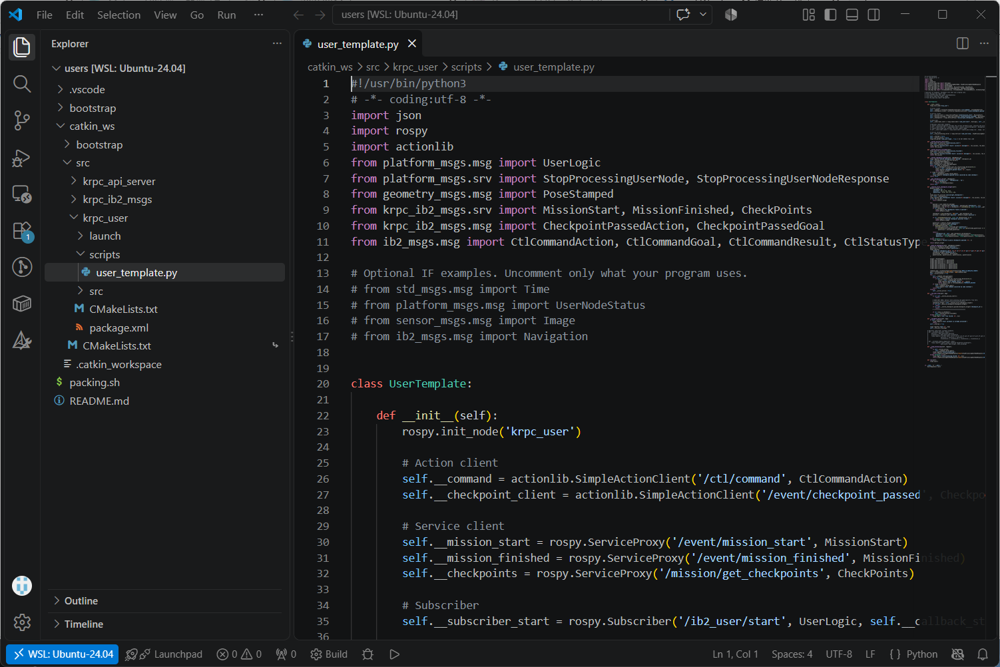

> [!NOTE]
> Downloading and extracting the development resources is explained in [2.5 Obtaining Development Resources](#25-obtaining-development-resources).

## 3.2 Modifying the Sample Code

1. Confirm that the sample code is located at `~/krpc/krpc7th-simulator/users/catkin_ws/src/krpc_user/`.
2. Modify the sample code as needed.
3. Once your changes are complete, run `users/packing.sh` to create the submission package.

> [!CHECK]
> `users/packing.sh` is a shell script. Run it in a Linux environment (Ubuntu). If you are using Windows, use an Ubuntu terminal on WSL2. Even if you only use the Web simulator, a Linux environment (Ubuntu) is required because this script is used to create the submission package.

```bash
cd ~/krpc/krpc7th-simulator/users
./packing.sh YourSourceCode
```
4. Run the created submission package on the Web simulator.

> [!NOTE]
> For running it on the local simulator, see [4.4 Local Simulator](#44-local-simulator).

# 4. Running Your Program in the Simulator

## 4.1 Types of Simulators

| Item | Web Simulator | Local Simulator |
|---|---|---|
| Main purpose | Pre-submission checks, evaluation in a common environment | Verifying behavior during development, debugging |
| Where it runs | Server managed by the Kibo-RPC organizers | Developer's PC |
| CPU architecture | Uses an ARM64 (aarch64) environment for conditions close to the actual hardware | Mainly the x86_64 environment used on typical developer PCs |
| Account used | An account issued after applying for registration with your country's or region's POC via [HP \| Kibo Robot Programming Challenge](https://jaxa.krpc.jp/) | Not required in principle |
| Logs | Available from the Web dashboard | Saved in the local environment |

## 4.2 Web Simulator

### 4.2.1 Logging in to My Page

1. Access [Login | Kibo Robot Programming Challenge](https://jaxa.krpc.jp/user-auth/).
2. Log in with the account issued by your country's or region's POC.
3. Confirm that your Kibo-RPC My Page is displayed.

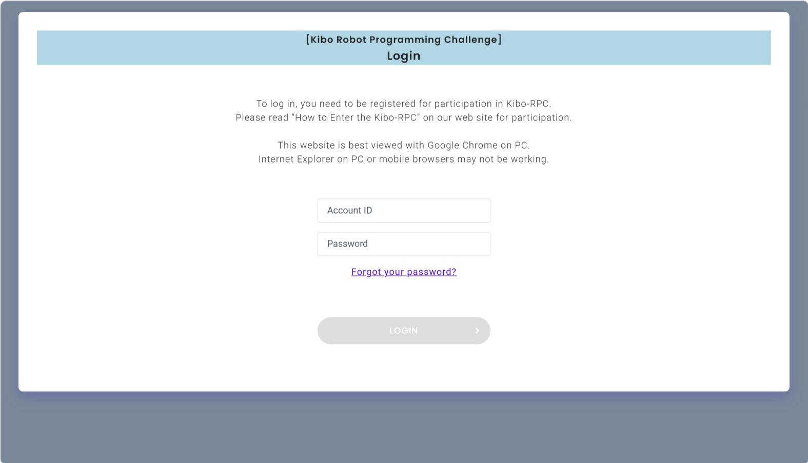

### 4.2.2 Running a Simulation

1. From the screen where your Kibo-RPC My Page is open, click `[SIMULATION]`.
2. Drag and drop the `YourSourceCode.tar.gz` you want to run onto the submission form, or select the file and submit it.

The submission form includes the following screen items.

| Item | Input method | Description |
|---|---|---|
| Simulator Level | Drop-down list | Select the simulation difficulty level. |
| Simulator Version | Drop-down list | Select the simulator version to use. |
| Memo | Text field | Enter notes associated with the simulation. |

3. Click `[START SIMULATION]`.
4. When a confirmation dialog appears, click `[OK]`.
5. Confirm that the simulation starts.

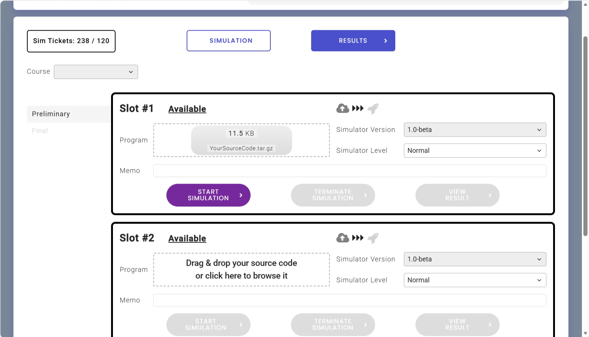
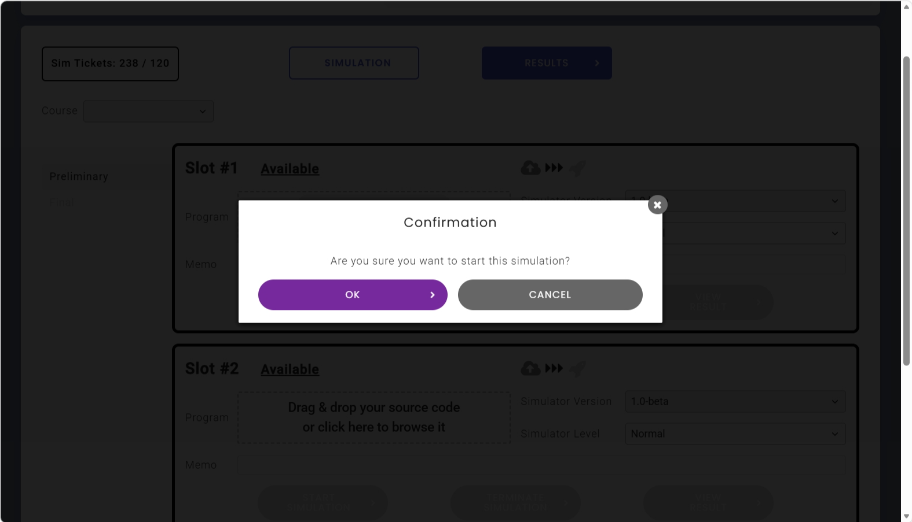
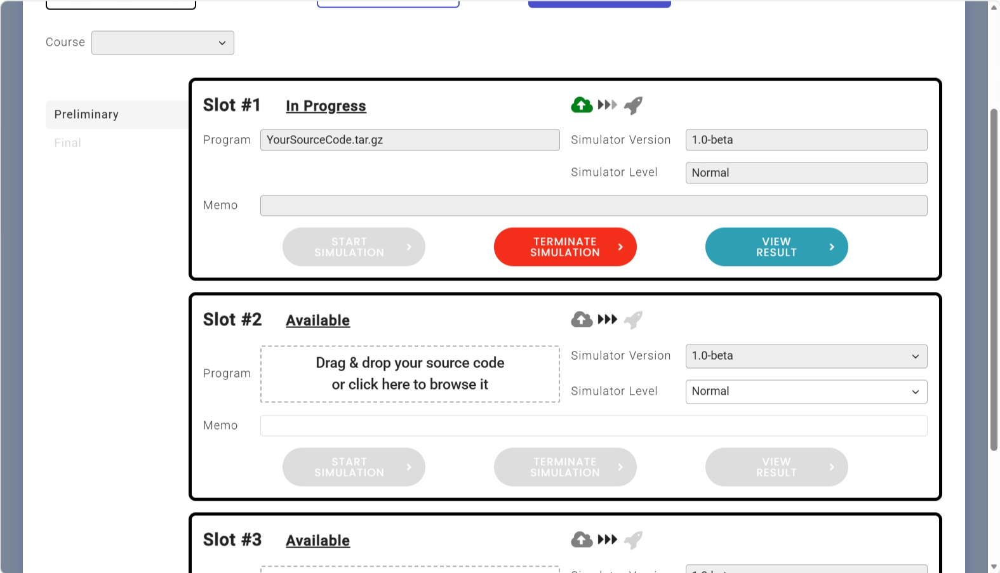

### 4.2.3 Checking Simulation Results

1. Confirm that the simulation has completed. A simulation whose Status is "Finished" has completed.
2. Click `[VIEW RESULT]` to check the results.

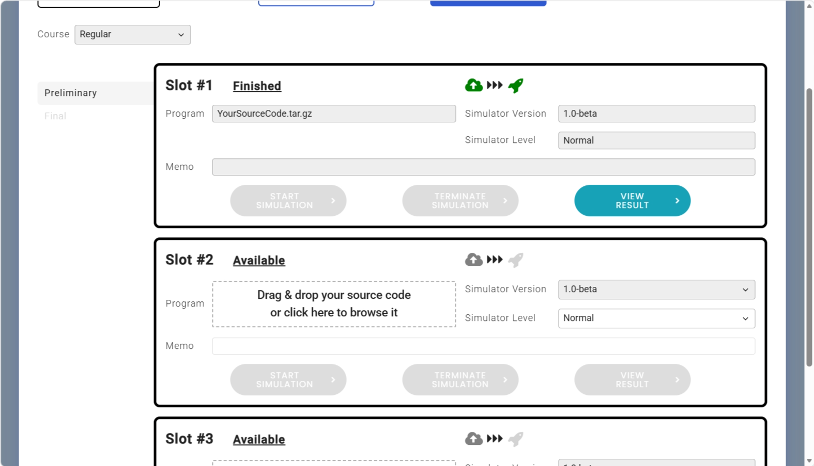

> [!NOTE]
> On the results screen, you can check the simulation status and score, and access various logs.
> For details on each screen item, see [4.3 Checking Simulation Results](#43-checking-simulation-results) below.

### 4.2.4 Replaying a Simulation

1. Open a simulation that is in the Finished state.
2. Click `[SIMULATOR VIEWER]`.
3. Copy the `[Password]` shown in the dialog that appears.
4. Click `[VIEW]` in the dialog.
5. The replay screen is displayed in a separate tab.
6. Adjust the `[Speed]` slider to set the playback speed.
7. Click `[Play]`.
8. Confirm that the simulation is replayed.

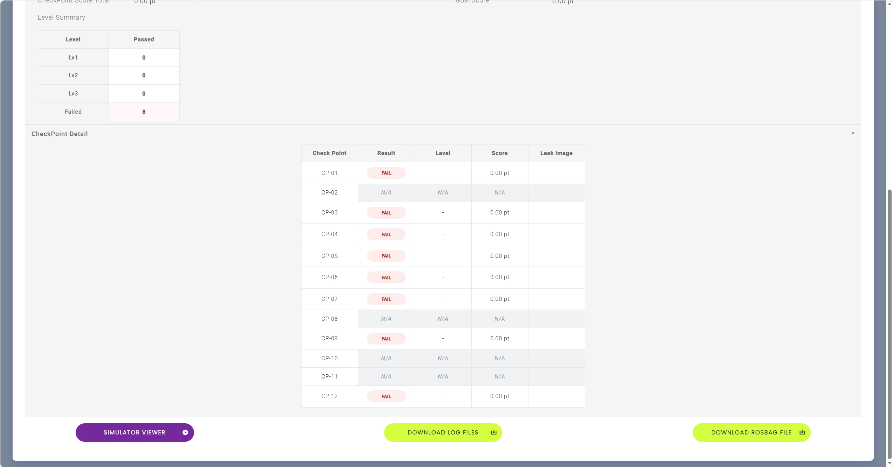
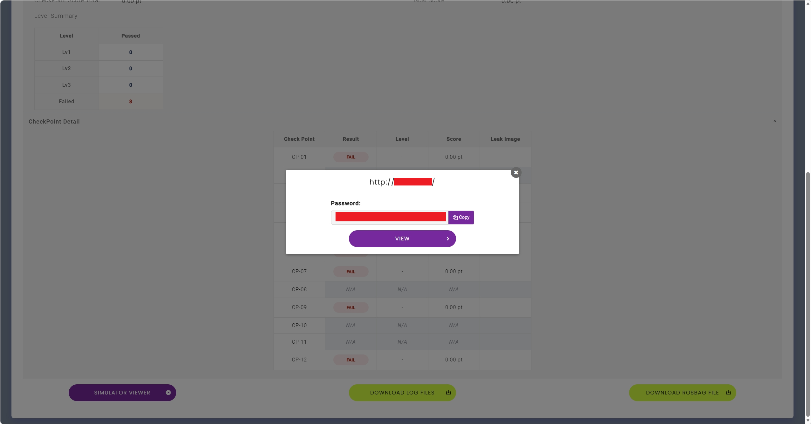
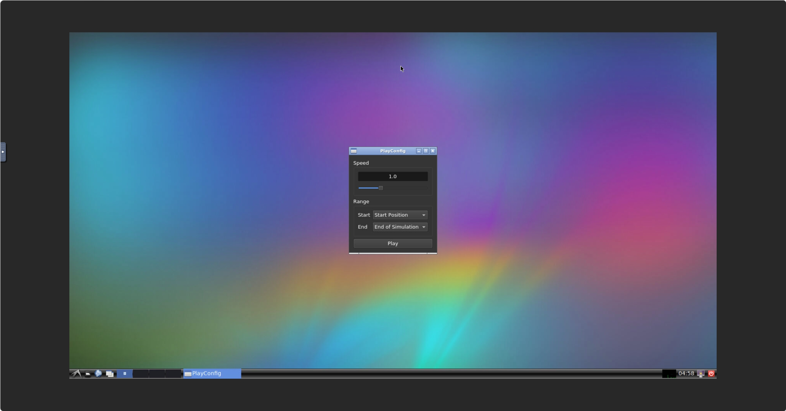
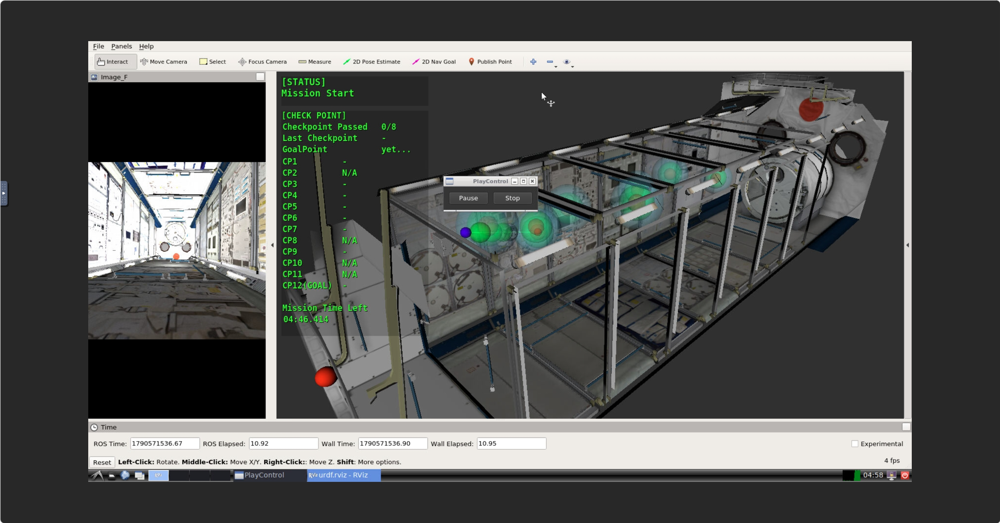

## 4.3 Checking Simulation Results

### 4.3.1 Results Screen

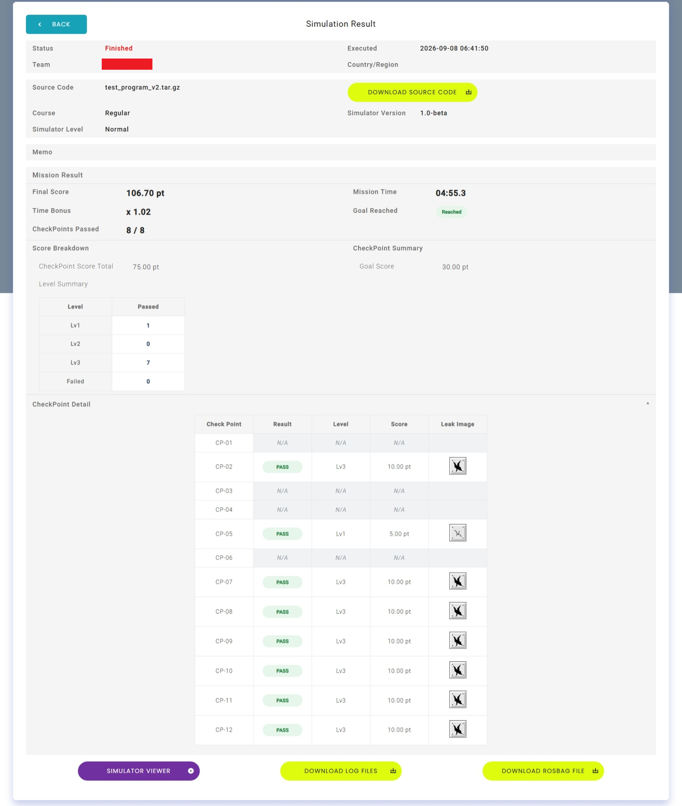

| Item | Description |
|---|---|
| Status | The execution status of the simulation |
| Executed | The date and time the simulation was run |
| Team | The name of the team that ran it |
| Country/Region | The country or region |
| Source Code | The file name of the source code that was run |
| Course | The course that was run |
| Simulator Level | The difficulty level of the simulation, such as Easy, Normal, Hard, or Very Hard |
| Simulator Version | The version of the simulator used for the run |
| Memo | Notes associated with the simulation |
| Final Score | The final score |
| Mission Time | The mission's execution time |
| Time Bonus | The multiplier applied for the simulation time |
| CheckPoints Passed | The number of checkpoints successfully passed |
| Goal Reached | Whether the goal was reached |

#### Score Breakdown

The score shown on the results screen is calculated from the following components. Checking each item lets you understand which actions contributed to the score.

- `CheckPoint Score Total`  
  The total score across all checkpoints.  
  You can check the details in CheckPoint Detail.

- `Level Summary`
  Shows the number of achievements at each level.

- `Goal Score`
  If the goal is judged to have been achieved, the goal score is added.

#### CheckPoint Detail

This list summarizes the pass/fail result for each checkpoint.
The number and placement of checkpoints vary depending on the difficulty. A CheckPoint shown as N/A means that checkpoint is not subject to evaluation.

- `Check Point`
  The identification number of the checkpoint. Indicates which marker or location was passed.

- `Result`
  Indicates whether that checkpoint was passed correctly. `PASSED` means success, and `FAIL` means it was not passed or failed.

- `Level`
  The overall evaluation level when passing a checkpoint. It is the lowest of the levels assigned to position, camera centering, and attitude around the line of sight. If any condition is outside its margin, the pass fails and `-` is displayed. `Lv3` is an example of a high evaluation when all three conditions are met. See [6.3.1 Mission Event API](#631-mission-event-api) for details on each condition.

- `Score`
  The score earned at that checkpoint. The score is determined by the evaluation level and is used to calculate the final score.

> [!TIP]
> If you want to improve your score, it is effective to first satisfy `CheckPoints Passed` and `Goal Reached`, and then maximize `Time Bonus`. For checkpoints, scoring depends not only on the position margin, but also on aiming the camera toward the marker center and meeting the attitude margin around the line of sight.

### 4.3.2 Downloading Log Files / Result Files

`[DOWNLOAD LOG FILES]` provides the following two kinds of files. They are separate files.

| Kind | Content |
|---|---|
| Result file (JSON) | The scoring result. It contains whether the run was treated as a violation, mission execution information, checkpoint details, goal results, and events that occurred during execution |
| User program log | The log output by the user program (for example, output from `rospy.loginfo`) |

1. Open the target simulation result.
2. Click `[DOWNLOAD LOG FILES]` to download the files.
3. Save the downloaded files.
4. Open the result file (JSON) and confirm that the simulation results are recorded.

> [!NOTE]
> The only files you can obtain from the execution results screen are the result file (JSON) above and the log output by the user program. System logs, simulator logs, communication logs, and sensor data are not provided.
> If you want to obtain communication or sensor data, use rosbag.
> rosbag is a standard ROS (Robot Operating System) data recording tool that can record and play back data from various topics inside the simulator.

#### Structure of the Result File (JSON)

| Item | Description |
|---|---|
| `Illegal` | Whether the run was treated as a violation |
| `JudgeReport.mission` | The mission's start/finish status, start time, finish time, and duration |
| `JudgeReport.checkpoint_detail` | Each checkpoint's number, success/failure, level, timestamp, and reason |
| `JudgeReport.goal` | Whether the goal was achieved, the reason for the judgment, and the timestamp reached |
| `JudgeReport.events` | The event history, such as mission start, checkpoint passes, and mission finish |

```json
{
  "Illegal": false,
  "JudgeReport": {
    "mission": {
      "started": true,
      "finished": true,
      "start": "19700101 000010160",
      "finish": "19700101 000505490",
      "duration_sec": 295.33
    },
    "checkpoint_detail": [
      {
        "checkpoint_id": 2,
        "success": true,
        "level": 3,
        "timestamp": "19700101 000125491",
        "reason": "checkpoint validated"
      }
    ],
    "goal": {
      "success": true,
      "reason": "goal checkpoint previously passed",
      "timestamp": "19700101 000505490"
    },
    "events": [
      {
        "status": "Mission Start",
        "timestamp": "19700101 000010160"
      },
      {
        "status": "Mission Finish",
        "timestamp": "19700101 000505490"
      }
    ]
  }
}
```

## 4.4 Local Simulator

### 4.4.1 Role of the Local Simulator

The local simulator's main purpose is iterative verification and debugging during development. Perform basic behavior checks with the local simulator, and perform the final behavior check with the Web simulator.

> [!NOTE]
> A typical PC uses the x86_64 CPU architecture.
> The actual Int-Ball2 hardware, on the other hand, is equipped with a Jetson TX2, whose CPU architecture is ARM64 (aarch64).
> Therefore, due to differences in CPU architecture, the program's behavior, processing speed, and available libraries may differ from the actual hardware.
>
> The Web simulator uses an ARM64 execution environment so that you can check conditions close to the actual hardware. However, this does not guarantee that the behavior of the Web simulator and the actual hardware will be completely identical.

### 4.4.2 Operating Environment

For the CPU, memory, storage, and OS conditions required to run the local simulator, see [2.2.1 Operating Environment for Running the Local Simulator](#221-operating-environment-for-running-the-local-simulator).
The local simulator runs inside a Docker container.

> [!WARNING]
> When you build and run the Docker image on an x86_64 PC, the CPU architecture differs from the ARM64 environment of the actual Int-Ball2 hardware. If you use libraries or processing that depend on the architecture, also verify their behavior on the Web simulator or on an ARM64 environment close to the actual hardware.

### 4.4.3 Building the Docker Image

Rather than installing the simulator itself individually on the host environment, the local simulator is run by building a Docker image. See [2.4.2 Installing Docker](#242-installing-docker) for how to install Docker.

```bash
cd ~/krpc/krpc7th-simulator
bash ./build.sh
```

`build.sh` accepts the following options.

| Option | Description |
|---|---|
| `--no-cache` | Builds without using the cache. |
| `--arm64` | Builds the local simulator image for the ARM64 architecture using QEMU emulation (`PLATFORM=linux/arm64`, `BASE_TAG=bionic-arm64`). This is useful for testing conditions close to the Web simulator and actual hardware. |
| `--platform=<platform>` | Explicitly specifies the target platform for the build (e.g., `--platform=linux/amd64`). |

> [!TIP]
> If the CPU architecture of the PC you are using is arm64, build with the `--arm64` option.
>
> ```bash
> bash ./build.sh --arm64
> ```

Confirm that the built Docker image was created successfully.

```bash
docker images
```

Expected result

```bash
REPOSITORY          TAG     IMAGE ID      CREATED     SIZE
krpc/krpc-simulator latest  5873e10aa5ee  5 days ago  6.29GB
```

### 4.4.4 Running a Simulation

```bash
cd ~/krpc/krpc7th-simulator
bash ./simulation.sh
```

### 4.4.5 Checking a Running Simulation

You can check the behavior of the local simulator in any browser.
Normally, you can access the local simulator at `http://localhost`.

> [!TIP]
> If you cannot access the URL above, check whether another application on your PC is using the HTTP port.
> If it is, change to any other port in `docker-compose.yaml`.

### 4.4.6 Stopping a Simulation

To stop it, press `Ctrl + C` in the terminal where it is running.
Alternatively, it stops automatically when the game completes.

# 5. Tips for Programming

## 5.1 Avoiding Infinite Loops

- Set an upper limit on the number of loop iterations.
- Set an upper limit on processing time.
- Prepare multiple exit conditions.
- Limit the number of retries when an API call fails.

> [!TIP]
> Having multiple exit conditions partway through a loop improves the safety of the processing. For external communication in particular, it is standard practice to limit both the timeout and the number of retries.

## 5.2 Error Handling

Consider the following:

- `null` checks
- Checking return values
- Exception handling
- Timeouts
- Communication disconnection
- Missing sensor data
- Abnormal values
- Retry limits
- Safe termination processing

## 5.3 Log Design

### Recommended Log Items

- Start and end of processing
- Application version
- Execution plan
- API name and execution result
- Target position and attitude
- Current position and attitude
- Sensor values
- Error codes
- Number of retries
- Processing time

### Log Levels

| Level | Purpose |
|---|---|
| ERROR | A problem where processing cannot continue |
| WARN | A condition that requires attention but is not fatal |
| INFO | Normal progress of processing |
| DEBUG | Detailed information for use during development |

## 5.4 Processing Time and Timeouts

- Record the start and end time of each process.
- Avoid waiting indefinitely for an external response.
- Check the remaining time for the overall mission.
- Measure the maximum time for image processing or inference processing.

## 5.5 Movement Processing

- Confirm the target position and attitude before moving.
- Always check the result of a movement.
- Limit the number of retries on failure.
- Take the flyable area and the vehicle's dimensions into account.
- Provide the necessary wait time after positioning completes.

## 5.6 Handling Sensor Data

- Assume that sensor values may not be obtainable.
- Check the timestamp.
- Avoid using stale data.
- Clearly specify the units and coordinate system.

## 5.7 Image Processing

- Check the size, format, and number of channels of the input image.
- Take brightness, reflections, blur, noise, and distortion into account.

## 5.8 Exception Handling and Retries

- When an exception occurs, finalize the current processing state.
- Log the error details, then handle the error so that it does not affect subsequent processing.
- Perform retries only after clarifying the reason for the retry and the number of attempts.
- Once a failure is confirmed, switch to a protective action such as stopping transmission or moving to a safe position.

## 5.9 Computational Resources

- Avoid continuing to hold unnecessary objects.
- Avoid duplicating large images or arrays.
- Consider splitting or simplifying long-running processing.

## 5.10 Numeric Conversion and Rounding

- Take rounding errors into account during unit conversion.
- Clearly define the rounding rules.
- Check that type conversions do not overflow.
- Check that errors from approximate calculations do not affect subsequent calculations.

## 5.11 Parallel Processing and Threads

- Avoid simultaneous access to shared data.
- Clearly define thread termination conditions.
- Set an upper limit on buffer and queue sizes.
- Clean up when stopping threads to prevent resource leaks.

## 5.12 Data Consistency and Boundary Value Checks

- Verify that input values are within the allowed range.
- Check time boundary values, coordinate extremes, and the vicinity of thresholds.
- Verify the state when externally dependent values change.
- Compare differences between execution environments to check they do not affect the results.

## 5.13 AR Marker Recognition

When recognizing an AR marker, detect the marker ID and the pixel coordinates of its four corners from the camera image, and estimate the marker's position and attitude using the camera's internal parameters. This section uses the ArUco module of OpenCV 3.3.1.

### 5.13.1 Information Required for Estimation

Prepare the following values to match the conditions of the camera that captures the image.

| Information | Content |
|---|---|
| Input image | Check the resolution, image format, and number of channels at the time of detection. |
| ArUco dictionary | A dictionary that defines the marker IDs and patterns. Match it to the markers being used. KRPC 7th uses a 4x4 dictionary. |
| Marker ID | The number that identifies the target marker after detection. KRPC 7th uses IDs 1 through 12. |
| Marker side length | Specify the actual size in meters, not the size on the image. KRPC 7th uses 2 cm (0.02 m). |
| Camera matrix | A 3x3 matrix containing the focal length and principal point. |
| Distortion coefficients | Lens distortion coefficients. Preserve the order from the calibration result. |

The camera matrix $K$ has the following form.

$$
K = \begin{bmatrix}
f_x & 0 & c_x \\
0 & f_y & c_y \\
0 & 0 & 1
\end{bmatrix}
$$

If you use `/camera_main/camera_info`, use `CameraInfo.K` as the camera matrix and `CameraInfo.D` as the distortion coefficients. If you resize the image, also change $f_x$, $f_y$, $c_x$, and $c_y$ by the same scale factor. If you crop the image, you also need to correct the principal point.

### 5.13.2 Detection and Pose Estimation Procedure

1. Convert the camera image to grayscale.
2. Create the ArUco dictionary and detection parameters to use.
3. Detect the marker ID and the pixel coordinates of its four corners using `detectMarkers`.
4. Select the target ID and estimate the pose by specifying the actual marker side length, the camera matrix, and the distortion coefficients.
5. Check the distance, the change in attitude, and the reprojection result, and check the stability across multiple frames if needed.

The `rvec` and `tvec` returned by `estimatePoseSingleMarkers` represent the transformation from the marker coordinate system to the camera coordinate system. The unit of `tvec` is the same as the marker side length, so it will be in meters if you specify the length in meters. In the normal OpenCV camera coordinate system, the right direction of the image is X, the downward direction of the image is Y, and the direction in front of the camera is Z. If you need to convert to the `iss_body` or `body` coordinate system, perform a separate conversion using the camera's mounting attitude.

> [!WARNING]
> If any of the dictionary, marker ID, marker side length, camera matrix, or distortion coefficients differ from the detection target, the marker may still be detected, but the distance or attitude will be incorrect. In particular, do not specify the marker side length as a pixel value.

#### Int-Ball2 Camera Mounting Position

The camera is mounted on the front of Int-Ball2, and its optical axis coincides with the front of the vehicle. The camera's mounting position and attitude are defined as follows, based on Int-Ball2's front (positive X-axis direction), left (positive Y-axis direction), and up (positive Z-axis direction).

```python
x = 0.14  # Offset toward the front (meters)
y = 0.00
z = 0.00
```

# 6. Game API Details

## 6.1 Common Notes When Using the API

This chapter covers the ROS interfaces used from the user program. The calling method is divided into ROS Service, ROS Action, ROS Topic, and ROS Parameter.

- ROS Service is used for processing that sends a request and receives a response.
- ROS Action is used for time-consuming processing such as movement. It involves connecting to the server, waiting for completion, and checking the result.
- ROS Topic is used to subscribe to continuously published data, such as self-position.
- ROS Parameter is used to get or change configuration values for the user program.
- Confirm that the communication partner is running before calling it.
- Always design a timeout, cancellation, and behavior at ROS shutdown for any ROS Action.

## 6.2 API List

In this chapter, the types used by Topics are called "message types," the types used by Services are called "service types," and the `.action` files behind Actions are called "Action definitions." A `.srv` definition generates a service type and Request/Response message types. An Action is not a single message type: its `.action` definition generates a type for Action clients, Goal/Result/Feedback message types, and message types that make up the Action communication protocol. Use the `...Action` type when creating an Action client and the `...Goal` type for the goal to send.

The API lists separate package names from definition file names. See the implementation reference tables in [6.2.5 Implementation Reference by Definition File (Python / C++)](#625-implementation-reference-by-definition-file-python--c) for the Python types and C++ headers/types used in code. ROS Parameters do not have definition files.

### 6.2.1 Mission Event API

| ROS Namespace | ROS Type | Package | Definition File | Purpose |
|---|---|---|---|---|
| /mission/get_checkpoints | Service | `krpc_ib2_msgs` | `CheckPoints.srv` | Obtains the checkpoint definitions |
| /event/mission_start | Service | `krpc_ib2_msgs` | `MissionStart.srv` | Notifies that the mission has started |
| /event/checkpoint_passed | Action | `krpc_ib2_msgs` | `CheckpointPassed.action` | Notifies that a checkpoint has been reached |
| /event/mission_finished | Service | `krpc_ib2_msgs` | `MissionFinished.srv` | Notifies that the mission has finished |

### 6.2.2 Position and Movement API

| ROS Namespace | ROS Type | Package | Definition File | Purpose |
|---|---|---|---|---|
| /sensor_fusion/navigation | Topic | `ib2_msgs` | `Navigation.msg` | Subscribes to self-position, attitude, velocity, and so on |
| /ctl/command | Action | `ib2_msgs` | `CtlCommand.action` | Requests control such as absolute movement, relative movement, stopping, or docking |
| /ctl/wrench | Topic | `geometry_msgs` | `WrenchStamped.msg` | Controls Int-Ball2 by directly applying translational force (force) and rotational torque (torque). Allows more seamless movement than using the `/ctl/command` Action, but is more difficult to use |
| /ctl/status | Topic | `ib2_msgs` | `CtlStatus.msg` | Obtains Int-Ball2's current control status |

### 6.2.3 Camera API

| ROS Namespace | ROS Type | Package | Definition File | Purpose |
|---|---|---|---|---|
| /camera_main/image_raw | Topic | `sensor_msgs` | `Image.msg` | Subscribes to the main camera's image |
| /camera_main/camera_info | Topic | `sensor_msgs` | `CameraInfo.msg` | Obtains the main camera's internal parameters (focal length, distortion coefficients, etc.) |

### 6.2.4 User Program Control API

| ROS Namespace | ROS Type | Package | Definition File / Value Type | Purpose |
|---|---|---|---|---|
| /ib2_user/start | Topic | `platform_msgs` | `UserLogic.msg` | Subscribes to the notification that the user program has started running (subscription mandatory) |
| /ib2_user/stop | Service | `platform_msgs` | `StopProcessingUserNode.srv` | Accepts a stop request for the user program (mandatory to provide when implementing on actual hardware) |
| /ib2_user/ready | Parameter | - | `bool` (no definition file) | Notifies that the user program is ready (mandatory to set) |

### 6.2.5 Implementation Reference by Definition File (Python / C++)

This section shows the types generated from definition files and how to use them in Python and C++. A complete definition path is "package name/type directory/definition file name." Do not import an `.action` file directly; use the generated `Action` and `Goal` types.

#### 6.2.5.1 Python

- **krpc_ib2_msgs/srv/CheckPoints.srv**

  ```python
  from krpc_ib2_msgs.srv import CheckPoints
  client = rospy.ServiceProxy('/mission/get_checkpoints', CheckPoints)
  ```

- **krpc_ib2_msgs/srv/MissionStart.srv**

  ```python
  from krpc_ib2_msgs.srv import MissionStart
  client = rospy.ServiceProxy('/event/mission_start', MissionStart)
  ```

- **krpc_ib2_msgs/action/CheckpointPassed.action**

  ```python
  import actionlib
  from krpc_ib2_msgs.msg import CheckpointPassedAction, CheckpointPassedGoal

  client = actionlib.SimpleActionClient('/event/checkpoint_passed', CheckpointPassedAction)
  goal = CheckpointPassedGoal()
  ```

- **krpc_ib2_msgs/srv/MissionFinished.srv**

  ```python
  from krpc_ib2_msgs.srv import MissionFinished
  client = rospy.ServiceProxy('/event/mission_finished', MissionFinished)
  ```

- **ib2_msgs/msg/Navigation.msg**

  ```python
  from ib2_msgs.msg import Navigation
  sub = rospy.Subscriber('/sensor_fusion/navigation', Navigation, callback)
  ```

- **ib2_msgs/action/CtlCommand.action**

  ```python
  import actionlib
  from ib2_msgs.msg import CtlCommandAction, CtlCommandGoal, CtlStatusType

  client = actionlib.SimpleActionClient('/ctl/command', CtlCommandAction)
  goal = CtlCommandGoal()
  ```

- **geometry_msgs/msg/WrenchStamped.msg**

  ```python
  from geometry_msgs.msg import WrenchStamped
  pub = rospy.Publisher('/ctl/wrench', WrenchStamped, queue_size=1)
  ```

- **ib2_msgs/msg/CtlStatus.msg**

  ```python
  from ib2_msgs.msg import CtlStatus
  sub = rospy.Subscriber('/ctl/status', CtlStatus, callback)
  ```

- **sensor_msgs/msg/Image.msg**

  ```python
  from sensor_msgs.msg import Image
  sub = rospy.Subscriber('/camera_main/image_raw', Image, callback)
  ```

- **sensor_msgs/msg/CameraInfo.msg**

  ```python
  from sensor_msgs.msg import CameraInfo
  sub = rospy.Subscriber('/camera_main/camera_info', CameraInfo, callback)
  ```

- **platform_msgs/msg/UserLogic.msg**

  ```python
  from platform_msgs.msg import UserLogic
  sub = rospy.Subscriber('/ib2_user/start', UserLogic, callback)
  ```

- **platform_msgs/srv/StopProcessingUserNode.srv**

  ```python
  from platform_msgs.srv import StopProcessingUserNode, StopProcessingUserNodeResponse
  server = rospy.Service('/ib2_user/stop', StopProcessingUserNode, callback)
  ```

- **ROS Parameter (no definition file)**

  ```python
  rospy.set_param('/ib2_user/ready', True)
  ```

#### 6.2.5.2 C++

- **krpc_ib2_msgs/srv/CheckPoints.srv**

  ```cpp
  #include <krpc_ib2_msgs/CheckPoints.h>

  ros::ServiceClient client = nh.serviceClient<krpc_ib2_msgs::CheckPoints>("/mission/get_checkpoints");
  krpc_ib2_msgs::CheckPoints service;
  client.call(service);
  ```

- **krpc_ib2_msgs/srv/MissionStart.srv**

  ```cpp
  #include <krpc_ib2_msgs/MissionStart.h>

  ros::ServiceClient client = nh.serviceClient<krpc_ib2_msgs::MissionStart>("/event/mission_start");
  krpc_ib2_msgs::MissionStart service;
  client.call(service);
  ```

- **krpc_ib2_msgs/action/CheckpointPassed.action**

  ```cpp
  #include <actionlib/client/simple_action_client.h>
  #include <krpc_ib2_msgs/CheckpointPassedAction.h>
  #include <krpc_ib2_msgs/CheckpointPassedGoal.h>

  actionlib::SimpleActionClient<krpc_ib2_msgs::CheckpointPassedAction> client("/event/checkpoint_passed", true);
  krpc_ib2_msgs::CheckpointPassedGoal goal;
  client.sendGoal(goal);
  ```

- **krpc_ib2_msgs/srv/MissionFinished.srv**

  ```cpp
  #include <krpc_ib2_msgs/MissionFinished.h>

  ros::ServiceClient client = nh.serviceClient<krpc_ib2_msgs::MissionFinished>("/event/mission_finished");
  krpc_ib2_msgs::MissionFinished service;
  client.call(service);
  ```

- **ib2_msgs/msg/Navigation.msg**

  ```cpp
  #include <ib2_msgs/Navigation.h>

  ros::Subscriber sub = nh.subscribe<ib2_msgs::Navigation>("/sensor_fusion/navigation", 1, callback);
  ```

- **ib2_msgs/action/CtlCommand.action**

  ```cpp
  #include <actionlib/client/simple_action_client.h>
  #include <ib2_msgs/CtlCommandAction.h>
  #include <ib2_msgs/CtlCommandGoal.h>
  #include <ib2_msgs/CtlStatusType.h>

  actionlib::SimpleActionClient<ib2_msgs::CtlCommandAction> client("/ctl/command", true);
  ib2_msgs::CtlCommandGoal goal;
  client.sendGoal(goal);
  ```

- **geometry_msgs/msg/WrenchStamped.msg**

  ```cpp
  #include <geometry_msgs/WrenchStamped.h>

  ros::Publisher pub = nh.advertise<geometry_msgs::WrenchStamped>("/ctl/wrench", 1);
  ```

- **ib2_msgs/msg/CtlStatus.msg**

  ```cpp
  #include <ib2_msgs/CtlStatus.h>

  ros::Subscriber sub = nh.subscribe<ib2_msgs::CtlStatus>("/ctl/status", 1, callback);
  ```

- **sensor_msgs/msg/Image.msg**

  ```cpp
  #include <sensor_msgs/Image.h>

  ros::Subscriber sub = nh.subscribe<sensor_msgs::Image>("/camera_main/image_raw", 1, callback);
  ```

- **sensor_msgs/msg/CameraInfo.msg**

  ```cpp
  #include <sensor_msgs/CameraInfo.h>

  ros::Subscriber sub = nh.subscribe<sensor_msgs::CameraInfo>("/camera_main/camera_info", 1, callback);
  ```

- **platform_msgs/msg/UserLogic.msg**

  ```cpp
  #include <platform_msgs/UserLogic.h>

  ros::Subscriber sub = nh.subscribe<platform_msgs::UserLogic>("/ib2_user/start", 1, callback);
  ```

- **platform_msgs/srv/StopProcessingUserNode.srv**

  ```cpp
  #include <platform_msgs/StopProcessingUserNode.h>

  ros::ServiceServer server = nh.advertiseService("/ib2_user/stop", callback);
  ```

- **ROS Parameter (no definition file)**

  ```cpp
  ros::param::set("/ib2_user/ready", true);
  ```

For the complete C++ template, see `users/catkin_ws/src/krpc_user/src/user_template_node.cpp`.

`/ib2_user/start`, `/ib2_user/stop`, and `/ib2_user/ready` are mandatory interfaces already implemented in the template. Do not remove or disable them.

## 6.3 API Details

### 6.3.1 Mission Event API

#### /mission/get_checkpoints

Obtains the checkpoint definitions. The request is empty, and a JSON string is returned in `message` of the response.

##### Service Definition

- CheckPoints.srv

```text
# Empty request

---
bool success
string message
```

##### Response Example

```json
{
  "checkpoint_count": 8,
  "checkpoints": [
    {
      "checkpoint_id": 1,
      "position": [1.4421152111823452, -0.5013235815457989, 0.6649623093633403],
      "marker_pose": {
        "position": [1.451, -1.001, 0.6806],
        "quaternion": [-0.707106781187, 0.0, 0.0, 0.707106781187]
      },
      "score_bands": [
        { "radius": 0.1, "level": 3 },
        { "radius": 0.2, "level": 2 },
        { "radius": 0.3, "level": 1 }
      ],
      "attitude": {
        "quaternion": [0.705928907230986, -0.689998801417597, 0.12254331978784033, -0.10270913665940805],
        "centering_bands": [
          { "angle": 10.0, "level": 3 },
          { "angle": 20.0, "level": 2 },
          { "angle": 30.0, "level": 1 }
        ],
        "roll_bands": [
          { "angle": 10.0, "level": 3 },
          { "angle": 20.0, "level": 2 },
          { "angle": 30.0, "level": 1 }
        ]
      }
    }
    ...
  ],
  "goalpoint_id": 12
}
```


> [!NOTE]
> The example above shows only the first element of the `checkpoints` array. In an actual response, `checkpoints` contains `checkpoint_count` elements in the same format.

When passing a checkpoint, the server evaluates these three conditions separately. Each condition has Lv1-Lv3 margins, and the lowest level among the condition results becomes the overall evaluation level. If any condition is outside its margin, the pass fails.

- **Position:** `score_bands` evaluates the distance between the vehicle and the checkpoint coordinates specified by `position`.
- **Camera centering:** `attitude.centering_bands` evaluates the angle between the camera's line of sight and the direction from the vehicle to the AR marker. This condition requires the marker to be near the center of the image.
- **Attitude around the line of sight:** `attitude.roll_bands` evaluates the difference in rotation around the camera's line of sight relative to the target attitude specified by `attitude.quaternion`.

The attitude conditions are evaluated when the response's `attitude` object defines the corresponding bands. Refer to the band definitions in the response for the margins and their associated levels.

#### /event/mission_start

Notifies that the mission has started. The request is empty.

##### Service Definition

- MissionStart.srv

```text
---
bool success
string message
```

#### /event/checkpoint_passed

This Action asks the server to evaluate whether the specified checkpoint has been passed. A successful movement Action alone does not confirm a pass. Send this after confirming that all three evaluation conditions are met and the vehicle is stable. The server evaluates the current state and returns the result in `success` of the Result.

##### Action Definition

- CheckpointPassed.action

```text
# Goal
int32 checkpoint_id

---
# Result
bool success
string message

---
# Feedback
string status
```

This `.action` definition generates the `CheckpointPassedAction` type for Action clients, the `CheckpointPassedGoal`, `CheckpointPassedResult`, and `CheckpointPassedFeedback` types for the goal, result, and feedback, and the `CheckpointPassedActionGoal`, `CheckpointPassedActionResult`, and `CheckpointPassedActionFeedback` types that make up the Action communication protocol. In Python, specify `CheckpointPassedAction` for the Action client and create the goal to send with `CheckpointPassedGoal`. `CheckpointPassed*` is explanatory shorthand for the related generated types, not a type name.

#### /event/mission_finished

Notifies that the mission has finished.

##### Service Definition

- MissionFinished.srv

```text
# Empty request

---
bool success
string message
```

### 6.3.2 Position and Movement API

#### /sensor_fusion/navigation

A Topic that continuously provides self-position, attitude, velocity, and acceleration.

##### Message Definition

- Navigation.msg

```text
geometry_msgs/PoseStamped pose
geometry_msgs/Twist twist
geometry_msgs/Vector3 a
NavigationStatus status
```

#### /ctl/command

Requests control such as movement or stopping by specifying a target position and attitude.

##### Action Definition

- CtlCommand.action

```text
# Goal
geometry_msgs/PoseStamped target
CtlStatusType type

---
# Result
uint8 TERMINATE_SUCCESS = 0
uint8 TERMINATE_ABORTED = 1
uint8 TERMINATE_TIME_OUT = 2
uint8 TERMINATE_INVALID_NAV = 3
uint8 TERMINATE_INVALID_CMD = 4
time stamp
uint8 type

---
# Feedback
duration time_to_go
geometry_msgs/Pose pose_to_go
```

This `.action` definition generates the `CtlCommandAction` type for Action clients, as well as types for the Goal, Result, and Feedback. In Python, specify `CtlCommandAction` for the Action client and create the goal with `CtlCommandGoal`.

The main `CtlStatusType` values are `MOVE_TO_ABSOLUTE_TARGET`, `MOVE_TO_RELATIVE_TARGET`, and `STOP_MOVING`.

##### About CtlStatusType

| Type | Description | Specifying `target` | Notes |
|---|---|---|---|
| `MOVE_TO_ABSOLUTE_TARGET` | Movement to an absolute position and attitude in the ISS reference coordinate system (`iss_body`) | Specify the absolute coordinates and attitude | `frame_id` is `iss_body` |
| `MOVE_TO_RELATIVE_TARGET` | Movement to a position and attitude relative to the vehicle coordinate system (`body`) | Specify the coordinates and attitude relative to the current position | `frame_id` is `body` |
| `STOP_MOVING` | Decelerates and stops the movement in progress, holding the current attitude in place | Not required (send filled with `0`) | After stopping, the state becomes equivalent to `KEEP_POSE` |

> [!NOTE]
> In addition to the above, `STAND_BY` and `KEEP_POSE`, which represent standby states, and `DOCK_WITHOUT_CORRECTION`, which specifies docking without marker correction, also exist as internal server states, but the three types above are mainly what the user program specifies as a target.

##### Cancelling Movement

If replanning or a stop is needed during movement, use the Action client's `cancel_goal()`. After requesting a cancellation, confirm that the Action has ended or the stop has completed before sending the next target.

###### Python Implementation Example

```python
command_client.cancel_goal()
if not command_client.wait_for_result(rospy.Duration(10.0)):
    rospy.logwarn('cancel did not complete')
```

#### /ctl/wrench

A Topic that controls Int-Ball2 by directly applying `force` (translational force) and `torque` (rotational torque). This allows more seamless movement of the vehicle than using the `/ctl/command` Action, but the difficulty is higher because the user program must manage reaching and stopping at the target position and attitude itself.

##### Message Definition

`/ctl/wrench` uses the standard `geometry_msgs/WrenchStamped` message type.

- WrenchStamped.msg

```text
Header header
Wrench wrench
```

- Wrench.msg

```text
Vector3 force
Vector3 torque
```

> [!NOTE]
> `force` is the translational force [N] in the vehicle coordinate system (`body`), and `torque` is the rotational torque [Nm] in the same coordinate system.
> Sending `/ctl/wrench` while moving via `/ctl/command` can result in unintended behavior depending on the vehicle's state transitions, so if you use both together, be sure to fully verify the state transitions.

#### /ctl/status

A Topic that continuously provides Int-Ball2's current control status (position, attitude, velocity, acceleration, and control state).

##### Message Definition

- CtlStatus.msg

```text
geometry_msgs/PoseStamped pose
geometry_msgs/Twist twist
geometry_msgs/Vector3 a
CtlStatusType type
```

- CtlStatusType.msg

```text
int32 STAND_BY                  =  0
int32 CAPTURED                  =  1
int32 DISTURBED                 =  2
int32 KEEP_POSE                 = 10
int32 KEEPING_POSE_BY_COLLISION = 11
int32 STOP_MOVING               = 20
int32 MOVE_TO_RELATIVE_TARGET   = 30
int32 MOVE_TO_ABSOLUTE_TARGET   = 40
int32 RELEASE                   = 50
int32 DOCK                      = 60
int32 MOVING_TO_AIA_AIP         = 61
int32 WAITING_AT_AIA_AIP        = 62
int32 MOVING_TO_RDA_AIP         = 63
int32 MOVING_TO_RDP             = 64
int32 DOCKING_STAND_BY          = 65
int32 DOCK_WITHOUT_CORRECTION   = 69
int32 SCAN                      = 70

int32 type
```

> [!NOTE]
> `type` represents the current control state corresponding to the `CtlStatusType` specified in `/ctl/command`. By checking whether the state has transitioned from a movement-related state such as `MOVE_TO_ABSOLUTE_TARGET` or `MOVE_TO_RELATIVE_TARGET` to `KEEP_POSE` or `STOP_MOVING`, you can poll for the completion or interruption of a movement.

### 6.3.3 Camera API

#### /camera_main/image_raw

A Topic that continuously publishes the main camera's image. It uses the standard ROS `sensor_msgs/Image`.

> [!TIP]
> If you use OpenCV for image recognition, convert `sensor_msgs/Image` to OpenCV format using `cv_bridge` or `ros_numpy`.

##### Message Definition

> [!NOTE]
> This uses the standard ROS `sensor_msgs/Image` message type. The main fields are shown here.

- Image.msg

```text
std_msgs/Header header
uint32 height
uint32 width
string encoding
uint8 is_bigendian
uint32 step
uint8[] data
```

#### /camera_main/camera_info

A Topic that publishes the main camera's internal parameters. It uses the standard ROS `sensor_msgs/CameraInfo`.

##### Message Definition

> [!NOTE]
> This uses the standard ROS `sensor_msgs/CameraInfo` message type. The main fields are shown here.

- CameraInfo.msg

```text
std_msgs/Header header
uint32 height
uint32 width
string distortion_model
float64[] D
float64[9] K
float64[9] R
float64[12] P
```
> [!TIP]
> `K` is the camera matrix, and `D` is the distortion coefficients. Use these when performing pose estimation in the camera coordinate system, such as AR marker detection.
> The cached `CameraInfo` object remains `None` until the first message is received, so check that it has been received before referencing `K` or `D`.

### 6.3.4 User Program Control API

#### /ib2_user/start

A Topic that notifies the template that the user program has started running.
The subscription to this Topic is already implemented in the template and must not be removed. To avoid starting twice, the callback checks whether it has already started.

##### Message Definition

- UserLogic.msg

```text
uint16 id
```

#### /ib2_user/stop

A Service that accepts a stop request for the user program.

##### Service Definition

- StopProcessingUserNode.srv

```text
# Empty request

---
uint8 SUCCESS = 0
uint8 ERROR = 255
uint8 result
```

> [!CHECK]
> When you receive a stop request, cancel any Action currently running before responding. If you do not return a response, the template's stop processing will not complete.
> See the template's `__stop_processing` method for an implementation example.

#### /ib2_user/ready

A ROS Parameter that notifies that the user program has finished initializing.

##### Python Configuration Example

```python
rospy.set_param('/ib2_user/ready', True)
```

> [!CHECK]
> This setting is already implemented in the template, and must not be removed. The `/ib2_user/start` event is not published until `/ib2_user/ready` becomes `true`.

## 6.4 Sample Source Code

The complete sample implementation is at `users/catkin_ws/src/krpc_user/scripts/user_template.py`. Refer to that file for the overall picture. This section explains how this template uses each of the APIs introduced in 6.2 and 6.3.

> [!NOTE]
> The code examples in this section are simplified to illustrate API usage and do not include all error handling required in production. For example, the shown `wait_for_service()` and `wait_for_server()` calls have no timeout, and the stop-request example tracks and cancels only the movement Action. In actual use, follow Section 6.5: add finite timeouts, track and cancel every running Action, and confirm that stopping has completed before responding.

### 6.4.1 Initialization (`__init__`)

In the constructor, prepare the clients for the mission event API and the movement API, together with the mandatory interfaces `/ib2_user/start`, `/ib2_user/stop`, and `/ib2_user/ready`.

```python
# Action client
self.__command = actionlib.SimpleActionClient('/ctl/command', CtlCommandAction)
self.__checkpoint_client = actionlib.SimpleActionClient('/event/checkpoint_passed', CheckpointPassedAction)

# Service client
self.__mission_start = rospy.ServiceProxy('/event/mission_start', MissionStart)
self.__mission_finished = rospy.ServiceProxy('/event/mission_finished', MissionFinished)
self.__checkpoints = rospy.ServiceProxy('/mission/get_checkpoints', CheckPoints)

# Subscriber
self.__subscriber_start = rospy.Subscriber('/ib2_user/start', UserLogic, self.__callback_start)  # DO NOT REMOVE THIS LINE

# Service server
self.__stop_processing_server = rospy.Service('/ib2_user/stop', StopProcessingUserNode, self.__stop_processing) # DO NOT REMOVE THIS LINE

self.__started = False
self.__action_active = False
rospy.set_param('/ib2_user/ready', True) # DO NOT REMOVE THIS LINE
```

As noted in the comments, do not remove the subscription to `/ib2_user/start`, the service provided at `/ib2_user/stop`, or the setting of `/ib2_user/ready`.

### 6.4.2 Mission Start Trigger (`__callback_start`)

The `/ib2_user/start` callback is the starting point for the entire mission flow. After a guard that prevents starting twice, it calls `__run_user_flow`.

```python
def __callback_start(self, msg):
    if self.__started:
        rospy.logwarn('start callback is already processed')
        return
    self.__started = True

    rospy.loginfo('start %s', msg)
    self.__run_user_flow(msg)
```

### 6.4.3 Overall Mission Flow (`__run_user_flow`)

In the sample, `__run_user_flow` controls the sequence of `/event/mission_start` → checkpoint processing → `/event/mission_finished`.
Add your team's own route planning and decision-making logic between the `USER EDIT AREA` markers.

```python
def __run_user_flow(self, msg):
    try:
        if not self.__notify_mission_start():
            return

        # USER EDIT AREA: define route planning and game-specific flow here.
        # ***********************************************
        checkpoint_target = self.__resolve_first_checkpoint_target()
        if not self.__move_to_checkpoint(checkpoint_target):
            return
        if not self.__notify_checkpoint_passed(checkpoint_target['checkpoint_id']):
            return
        # ***********************************************

        if not rospy.is_shutdown():
            self.__notify_mission_finished()
    except Exception as exc:
        rospy.logerr('user flow failed: %s', exc)
```

This example shows the basic flow of sending a pass notification after the movement Action succeeds. In an actual mission, confirm that the vehicle is stable and meets the camera-centering and attitude conditions around the line of sight, in addition to confirming movement success. The server evaluates the checkpoint level.

### 6.4.4 Calling the Mission Event API

`/event/mission_start` and `/event/mission_finished` are implemented as thin wrappers (`__notify_mission_start` and `__notify_mission_finished`) that simply wait with `wait_for_service()` before calling, and then check `success`.

```python
def __notify_mission_start(self):
    rospy.wait_for_service('/event/mission_start')
    res = self.__mission_start()
    rospy.loginfo('mission_start result: success=%s message=%s', res.success, res.message)
    return res.success
```

`/mission/get_checkpoints` is called from `__resolve_first_checkpoint_target`, which parses the JSON string in the response (`message`) to obtain the first checkpoint's `position` and `attitude.quaternion` as the movement target. This sets the target position and attitude; it does not guarantee that the camera-centering or attitude conditions around the line of sight are met. If obtaining or parsing fails, it returns a default target at the origin so that the template can still run the whole flow (move -> pass notification -> mission finish) without stopping partway. This is an implicit value for verifying that the template works; it does not earn any score. In an actual mission, replace it with the behavior you intend, such as logging the failure and then retrying the request or aborting.

```python
rospy.wait_for_service('/mission/get_checkpoints')
res = self.__checkpoints()
rospy.loginfo('get_checkpoints result: success=%s message=%s', res.success, res.message)
if not res.success:
    return default_target
```

`/event/checkpoint_passed` is called from `__notify_checkpoint_passed`. It waits for the Action to complete by polling `wait_for_result(0.2)`, and cancels with `cancel_goal()` if ROS is shutting down.

```python
self.__checkpoint_client.wait_for_server()
goal = CheckpointPassedGoal()
goal.checkpoint_id = checkpoint_id
self.__checkpoint_client.send_goal(goal)
while not rospy.is_shutdown():
    if self.__checkpoint_client.wait_for_result(rospy.Duration(0.2)):
        result = self.__checkpoint_client.get_result()
        rospy.loginfo('checkpoint_passed result: %s', result)
        return result.success
if rospy.is_shutdown():
    self.__checkpoint_client.cancel_goal()
    rospy.logwarn('checkpoint_passed action cancelled by node shutdown')
return False
```

### 6.4.5 Calling `/ctl/command` (`__move_to_checkpoint`)

Using the position and attitude obtained from `__resolve_first_checkpoint_target`, this builds a `PoseStamped` and sends it to `/ctl/command` with `CtlStatusType.MOVE_TO_ABSOLUTE_TARGET` specified. The result is judged by comparing it against `CtlCommandResult.TERMINATE_SUCCESS`.

```python
command_type = CtlStatusType(type=CtlStatusType.MOVE_TO_ABSOLUTE_TARGET)
goal = CtlCommandGoal(target=target, type=command_type)
self.__action_active = True
try:
    self.__command.send_goal(goal)
    while not rospy.is_shutdown():
        if self.__command.wait_for_result(rospy.Duration(0.2)):
            result = self.__command.get_result()
            rospy.loginfo('move command result: %s', result)
            return result.type == CtlCommandResult.TERMINATE_SUCCESS
    if rospy.is_shutdown():
        self.__command.cancel_goal()
        rospy.logwarn('move command cancelled by node shutdown')
    return False
finally:
    self.__action_active = False
```

`self.__action_active` is used to determine whether to cancel the currently running Action when `/ib2_user/stop` is received.

### 6.4.6 Handling Stop Requests (`__stop_processing`)

When `/ib2_user/stop` is received, if a movement Action is running, it is canceled before the response is returned.

```python
def __stop_processing(self, request):
    try:
        if self.__action_active:
            self.__command.cancel_goal()
        rospy.loginfo('finish processing')
        return StopProcessingUserNodeResponse(result=StopProcessingUserNodeResponse.SUCCESS)
    except Exception as exc:
        rospy.logerr('stop processing failed: %s', exc)
        return StopProcessingUserNodeResponse(result=StopProcessingUserNodeResponse.ERROR)
```

### 6.4.7 Adding Optional APIs (Position and Camera)

`/sensor_fusion/navigation` and `/camera_main/image_raw` are provided in the template as commented-out examples. If you want to use them, uncomment the corresponding lines.

```python
# self.__subscriber_nav = rospy.Subscriber('/sensor_fusion/navigation', Navigation, self.__callback_nav)
# self.__subscriber_camera = rospy.Subscriber('/camera_main/image_raw', Image, self.__callback_camera_image)
```

### 6.4.8 Implementation Example in C++14

If you implement in C++14, an equivalent template is available at `users/catkin_ws/src/krpc_user/src/user_template_node.cpp`. As with the Python version, it subscribes to `/ib2_user/start`, provides the `/ib2_user/stop` service, sets `/ib2_user/ready`, and calls `get_checkpoints`, `/ctl/command`, `checkpoint_passed`, and `mission_finished` using a combination of actionlib and `ros::ServiceClient`/`ServiceServer`.

## 6.5 Basic Policy for Error Handling

| Situation | Response |
|---|---|
| A Service is unavailable | Wait with `wait_for_service()` and end the process if it exceeds a time limit |
| An Action server is unavailable | Wait with `wait_for_server()` and do not start execution |
| A movement failed | Do not send the arrival notification, and record the cause in the log |
| An Action timed out | Call `cancel_goal()` and confirm that the stop has completed |
| `checkpoint_passed` failed | Record the `message` or Result, and do not resend the same request indefinitely |
| Camera images or camera_info do not arrive | If no fresh camera data arrives within a defined timeout, log the issue and skip camera-dependent processing |
| `/ib2_user/stop` was received | Cancel any running Action, terminate processing safely, and then respond |